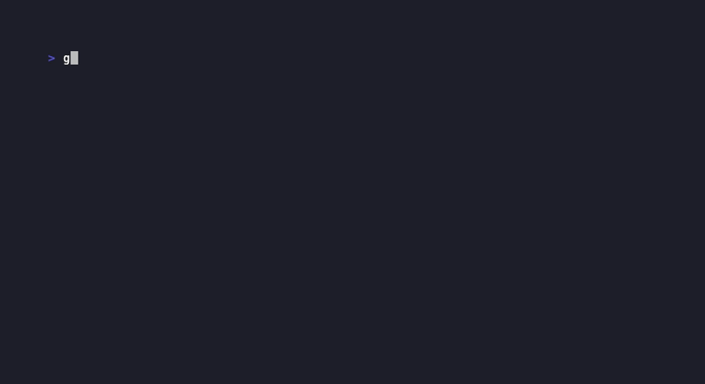

[简体中文](./README.zh-CN.md) · [Website](https://forkspan.lei6393.com) · [GitHub](https://github.com/SuperMarioYL/forkspan)

<picture>
  <source media="(max-width: 600px) and (prefers-color-scheme: dark)" srcset="./assets/presentation/hero-mobile-dark.svg">
  <source media="(max-width: 600px)" srcset="./assets/presentation/hero-mobile-light.svg">
  <source media="(prefers-color-scheme: dark)" srcset="./assets/presentation/hero-dark.svg">
  
</picture>

# forkspan

**Inspect an agent trace at the point that matters.**

ForkSpan loads recorded OTLP GenAI spans into a navigable tree and exports a StateSnapshot at a selected span.

## Why use it

A suspicious tool call is easier to investigate when its parent spans and reachable downstream calls stay visible. ForkSpan turns a trace export into a local inspection surface with a scriptable snapshot path.

- **Inspect a selected span** — Export the recorded state at an explicit ID.
- **Use a terminal or scripts** — TUI navigation and JSON output share the same trace model.
- **Keep the trace local** — Inspection needs no model call or remote service.

## Architecture

<picture>
  <source media="(max-width: 600px) and (prefers-color-scheme: dark)" srcset="./assets/presentation/architecture-mobile-dark.svg">
  <source media="(max-width: 600px)" srcset="./assets/presentation/architecture-mobile-light.svg">
  <source media="(prefers-color-scheme: dark)" srcset="./assets/presentation/architecture-dark.svg">
  
</picture>

ingest parses the OTLP export and builds the span relationships. The TUI renders the tree, and snapshot capture collects the recorded state at the selected ID. The current fork and replay commands are roadmap placeholders; no counterfactual execution is performed.

| Component | Responsibility |
| --- | --- |
| `OTLP JSON` | internal/ingest/otlp.go |
| `Span tree` | internal/ingest/model.go |
| `Snapshot` | internal/fork/snapshot.go |
| `TUI / JSON` | internal/tui |

## Install and quickstart

Build with the version declared in the repository manifest. Run the example from the repository root.

```bash
git clone https://github.com/SuperMarioYL/forkspan.git
cd forkspan
go build ./cmd/forkspan
```

List the complete synthetic compromised-agent trace included in assets/sample-compromised-trace.json.

```bash
go run ./cmd/forkspan inspect assets/sample-compromised-trace.json --list
```

## Recorded demo

<picture>
  <source media="(max-width: 600px) and (prefers-color-scheme: dark)" srcset="./assets/presentation/process-mobile-dark.svg">
  <source media="(max-width: 600px)" srcset="./assets/presentation/process-mobile-light.svg">
  <source media="(prefers-color-scheme: dark)" srcset="./assets/presentation/process-dark.svg">
  
</picture>

The recorded tree exposes the marked intrusion span and its downstream tool-call spans.

```text
[Agent]  agent.invoke  0102030405060708
  [LLM]    llm.chat  [intrusion]  0a0b0c0d0e0f0a0b
    [Tool]   tool.call.bash  1112131415161718
    [Tool]   tool.call.http  2122232425262728
  [LLM]    llm.chat  3132333435363738
    [Tool]   tool.call.search  4142434445464748
```

The complete command and output are recorded in [docs/demo-results.json](./docs/demo-results.json). Inputs and reproduction code are included in the repository.



The existing recording is retained for context; the text example above documents the reproducible scenario.

## Usage

The CLI exposes the following operations. Commands after the example use your own paths or identifiers.

```bash
go run ./cmd/forkspan inspect assets/sample-compromised-trace.json --list
go run ./cmd/forkspan inspect assets/sample-compromised-trace.json -s 0a0b0c0d0e0f0a0b --json
# Interactive navigation requires a terminal:
go run ./cmd/forkspan inspect assets/sample-compromised-trace.json
```

### Inspect the snapshot JSON

The selected span has two reached spans (the root and the selected LLM span) and two downstream tool-call IDs. With Python 3, this command projects the relevant fields from the real JSON output; the full snapshot also contains attributes, timing and agent state.

```bash
go run ./cmd/forkspan inspect assets/sample-compromised-trace.json \
  -s 0a0b0c0d0e0f0a0b --json | python3 -c '
import json, sys
s = json.load(sys.stdin)
print(json.dumps({"at_span_id": s["at_span_id"], "reached_spans": [
    {k: span[k] for k in ("span_id", "name", "role", "intrusion")}
    for span in s["reached_spans"]
], "reachable_tool_calls": s["reachable_tool_calls"]}, separators=(",", ":")))'
```

```json
{"at_span_id":"0a0b0c0d0e0f0a0b","reached_spans":[{"span_id":"0102030405060708","name":"agent.invoke","role":"Agent","intrusion":false},{"span_id":"0a0b0c0d0e0f0a0b","name":"llm.chat","role":"LLM","intrusion":true}],"reachable_tool_calls":["1112131415161718","2122232425262728"]}
```

## Configuration

--list prints the recorded tree without opening a TUI. --snapshot/-s selects a span. --json writes the snapshot to stdout; --out/-o also selects a file destination. In the TUI use j/k to navigate, m to mark, s to save, and q to quit.

## Integrations and responsibilities

<picture>
  <source media="(max-width: 600px) and (prefers-color-scheme: dark)" srcset="./assets/presentation/integrations-mobile-dark.svg">
  <source media="(max-width: 600px)" srcset="./assets/presentation/integrations-mobile-light.svg">
  <source media="(prefers-color-scheme: dark)" srcset="./assets/presentation/integrations-dark.svg">
  
</picture>

The following routes are implemented in the source. Choose the input that matches your task and keep the resulting artifact with your project.

| Route | Implemented role |
| --- | --- |
| OTLP JSON | Recorded GenAI spans |
| Terminal TUI | Navigate and mark spans |
| StateSnapshot JSON | Scriptable state export |
| Span IDs | Non-interactive tree listing |

## Limits and next steps

- fork and replay are not implemented; their current commands print roadmap guidance.
- Recorded reachability is not proof of causal responsibility. No model or tool is re-executed.
- The bundled compromised trace is synthetic and contains no live incident data.

Counterfactual projection, branch diffs and live replay are future work. The implemented workflow is trace inspection and recorded-state export.

## License and contributions

See [LICENSE](./LICENSE). When reporting an issue, include a minimal input, the command, and the observed output.
