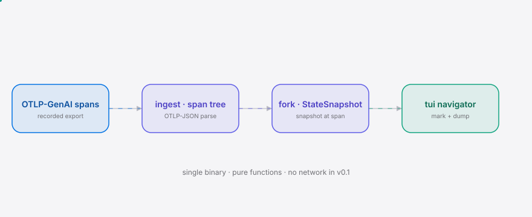

<div align="right"><sub><b>EN</b>&nbsp;&nbsp;⇄&nbsp;&nbsp;<a href="./README.zh-CN.md">中文</a></sub></div>

<picture>
  <source media="(prefers-color-scheme: dark)" srcset="./assets/hero-dark.svg">
  <source media="(prefers-color-scheme: light)" srcset="./assets/hero-light.svg">
  
</picture>

<p align="center"><sub>ForkSpan is the fork primitive that counterfactually replays compromised agent runs for IR engineers.</sub></p>

**Stop killing the run and losing the causal chain — fork the recorded state at the intrusion span and replay counterfactual branches to localize the trigger payload.**

<p align="center">
  <a href="./LICENSE"></a>
  &nbsp;<a href="https://github.com/SuperMarioYL/forkspan/releases"></a>
  &nbsp;<a href="https://github.com/SuperMarioYL/forkspan/actions/workflows/ci.yml"></a>
  &nbsp;
  &nbsp;
</p>

## Table of Contents

- [Why this exists](#why-this-exists)
- [Architecture](#architecture)
- [Install](#install)
- [Quickstart](#quickstart)
- [Usage](#usage)
- [Demo](#demo)
- [Roadmap](#roadmap)
- [License](#license)

## Why this exists

When an autonomous agent is subverted mid-run (prompt injection, tool-call hijack, policy escape), the only safe action today is to kill the run — which severs the causal chain that would explain *how* the subversion triggered. The IR loop is left with a read-only timeline and an inference, never a controlled experiment. ForkSpan makes "fork the recorded state at span X and replay counterfactuals" a first-class primitive operated over OTel-GenAI spans, so an operator can *prove* which payload drove the subversion instead of arguing it. The OTel-GenAI span standard is the unlock: a common span unit at which state can be snapshotted and across which branch diffs are machine-checkable. This is the agentic forensic primitive that the [affaan-m/ECC](https://github.com/affaan-m/ECC) agent-runtime orbit has been missing — closest analog is [langgenius/dify](https://github.com/langgenius/dify) for agent flows, but none forks counterfactual branches over recorded spans.

> **Honesty seam:** v0.1 projects counterfactuals *structurally* over recorded spans — it does not re-run the LLM. Every uncertain divergence is flagged via `NeedsReExec` rather than silently claimed. Live re-execution is post-v0.1.

<h2> Architecture</h2>

<picture>
  <source media="(prefers-color-scheme: dark)" srcset="./assets/atlas-dark.svg">
  <source media="(prefers-color-scheme: light)" srcset="./assets/atlas-light.svg">
  
</picture>

Single binary, three layers, no daemons, no network in v0.1. Ingest is a pure JSON parse (no OTLP collector, no live tail). Fork and diff are pure functions over the span tree. The TUI is the only interactive surface — one process, one binary, one config-free command for the demo.

<h2> Install</h2>

```bash
go install github.com/SuperMarioYL/forkspan/cmd/forkspan@latest
```

Or build from source:

```bash
git clone https://github.com/SuperMarioYL/forkspan
cd forkspan && go build -o forkspan ./cmd/forkspan
```

Requires Go 1.24+. macOS/Linux primary (TUI/tty); Windows is best-effort.

<h2> Quickstart</h2>

```bash
go build -o forkspan ./cmd/forkspan
./forkspan inspect assets/sample-compromised-trace.json            # open the navigator on the bundled compromised-agent trace
./forkspan inspect assets/sample-compromised-trace.json -s 0a0b0c0d0e0f0a0b --json   # dump the StateSnapshot at the intrusion span
```

<details><summary>sample output</summary>

```
{"at_span_id":"0a0b0c0d0e0f0a0b","reached_spans":[
  {"span_id":"0102030405060708","name":"agent.invoke","role":"Agent","kind":"SPAN_KIND_INTERNAL","status":{"code":"STATUS_CODE_OK","message":""},"intrusion":false,...},
  {"span_id":"0a0b0c0d0e0f0a0b","name":"llm.chat","role":"LLM","kind":"SPAN_KIND_INTERNAL","status":{"code":"STATUS_CODE_OK","message":""},"intrusion":true,...}],
 "reachable_tool_calls":["1112131415161718","2122232425262728"],
 "agent_state":{...}}
```
</details>

<h2> Usage</h2>

The three subcommands are `inspect` (m1, implemented), `fork` and `replay` (m2/m3, roadmap pointer).

```bash
# 1. Navigate the recorded span tree, mark the intrusion span, fork the StateSnapshot.
./forkspan inspect trace.json
#   j/k navigate · m mark intrusion · s fork StateSnapshot → forkspan-snapshot.json · q quit

# 2. Print the recorded span tree non-interactively to discover span IDs (CI / scripting friendly).
./forkspan inspect trace.json --list

# 3. Non-interactive snapshot dump to stdout (pipe a span id from --list).
./forkspan inspect trace.json -s <spanId> --json > snapshot.json

# 4. Counterfactual fork + replay (m2 milestone — prints a roadmap pointer in v0.1).
./forkspan fork --span <spanId> --block-tool bash
./forkspan replay --branch <id>
```

The bundled `assets/sample-compromised-trace.json` is a synthetic HF-incident-style trace: an `agent.invoke` run where a prompt-injection payload in an `llm.chat` span (pre-marked `forkspan.intrusion=true`) drove two exfiltration tool calls (`bash` → `http`). The intrusion span's reachable tool-call set is exactly those two exfil calls — the blast radius the counterfactual (m2) would project + diff.

<h2> Demo</h2>


The flow above is scripted in [`docs/demo.tape`](./docs/demo.tape) and re-rendered by the `demo` workflow on demand; the committed `assets/demo.gif` is the source of truth. The m1 milestone runs the inspect + snapshot-dump path end to end on the bundled trace.

<h2> Roadmap</h2>

- [x] **m1 — ingest + navigate.** Parse an OTLP-GenAI JSON export into a span tree + tool-call subgraph; TUI navigator marks any span as the intrusion span and dumps the `StateSnapshot`.
- [ ] **m2 — fork + diff.** Snapshot state at the marked span, apply a counterfactual mutation (block tool / redact payload / harden policy), project the downstream tool-call subgraph, and render side-by-side recorded-vs-counterfactual diff with `NeedsReExec` flags.
- [ ] **m3 — polish + demo.** Bundled sample compromised-agent trace, asciinema cast, one-shot `forkspan demo` reproducing the full fork/inspect/replay flow in under 2 minutes.
- [ ] **post-v0.1 — live re-exec.** Deterministic agent replay over snapshotted state to confirm uncertain divergences (closes the `NeedsReExec` seam).

### ForkSpan vs. adjacent tooling

| Axis | ForkSpan | [affaan-m/ECC](https://github.com/affaan-m/ECC) |
|---|---|---|
| Counterfactual fork at a span | ✓ | — |
| Recorded-state snapshot (no re-run) | ✓ | — |
| OTel-GenAI span consumer | ✓ | partial |
| Live eval / re-execution harness | partial (`NeedsReExec`) | ✓ |
| Intrusion-forensics focus | ✓ | — |

ECC is the broader agent-runtime/eval reference; ForkSpan is complementary — a forensic consumer of the spans those runtimes already collect, not a competitor.

<h2> License</h2>

MIT — see [LICENSE](./LICENSE). Issues and PRs welcome; file an issue with a redacted compromised-agent trace to reproduce the fork flow on real data.

After pushing, set the repo topics so the forensic audience finds it:

```bash
gh repo edit --add-topic agent --add-topic otel --add-topic opentelemetry --add-topic forensics --add-topic llm-agents --add-topic tracing
```

## Share this

```
ForkSpan — the Agent fork primitive for compromised agent runs. Snapshot the recorded state at the intrusion span over OTel-GenAI spans, replay counterfactuals to localize the trigger payload without killing the run. https://github.com/SuperMarioYL/forkspan
```

<p align="center"><sub><a href="./LICENSE">MIT</a> © 2026 SuperMarioYL</sub></p>
