[English](./README.md) · [Website](https://forkspan.lei6393.com) · [GitHub](https://github.com/SuperMarioYL/forkspan)

<picture>
  <source media="(max-width: 600px) and (prefers-color-scheme: dark)" srcset="./assets/presentation/hero-mobile-dark.svg">
  <source media="(max-width: 600px)" srcset="./assets/presentation/hero-mobile-light.svg">
  <source media="(prefers-color-scheme: dark)" srcset="./assets/presentation/hero-dark.svg">
  
</picture>

# forkspan

**从关键 Span 检查 Agent 轨迹。**

ForkSpan 把记录的 OTLP GenAI Span 加载成可浏览的树，并在选定 Span 导出 StateSnapshot。

## 为什么需要它

调查可疑工具调用时，需要看到上游 Span 与可达的后续调用。ForkSpan 将轨迹导出文件转成本地检查界面，并提供可脚本化的快照导出。

- **聚焦选定 Span** — 按明确 ID 导出记录状态。
- **终端与脚本都可使用** — TUI 与 JSON 输出使用同一轨迹模型。
- **轨迹留在本地** — 检查无需模型调用或远程服务。

## 架构

<picture>
  <source media="(max-width: 600px) and (prefers-color-scheme: dark)" srcset="./assets/presentation/architecture-mobile-dark.svg">
  <source media="(max-width: 600px)" srcset="./assets/presentation/architecture-mobile-light.svg">
  <source media="(prefers-color-scheme: dark)" srcset="./assets/presentation/architecture-dark.svg">
  
</picture>

ingest 解析 OTLP 文件并建立 Span 关系；TUI 展示树，快照模块按选定 ID 收集记录状态。当前 fork 和 replay 命令是路线图占位，不执行反事实运行。

| 组件 | 职责 |
| --- | --- |
| `OTLP JSON` | internal/ingest/otlp.go |
| `Span tree` | internal/ingest/model.go |
| `Snapshot` | internal/fork/snapshot.go |
| `TUI / JSON` | internal/tui |

## 安装与快速上手

使用仓库清单指定的运行时版本构建，并在仓库根目录运行示例。

```bash
git clone https://github.com/SuperMarioYL/forkspan.git
cd forkspan
go build ./cmd/forkspan
```

列出 assets/sample-compromised-trace.json 中随仓提供的完整合成异常轨迹。

```bash
go run ./cmd/forkspan inspect assets/sample-compromised-trace.json --list
```

## 实际运行示例

<picture>
  <source media="(max-width: 600px) and (prefers-color-scheme: dark)" srcset="./assets/presentation/process-mobile-dark.svg">
  <source media="(max-width: 600px)" srcset="./assets/presentation/process-mobile-light.svg">
  <source media="(prefers-color-scheme: dark)" srcset="./assets/presentation/process-dark.svg">
  
</picture>

The recorded tree exposes the marked intrusion span and its downstream tool-call spans.

```text
[Agent]  agent.invoke  0102030405060708
  [LLM]    llm.chat  [intrusion]  0a0b0c0d0e0f0a0b
    [Tool]   tool.call.bash  1112131415161718
    [Tool]   tool.call.http  2122232425262728
  [LLM]    llm.chat  3132333435363738
    [Tool]   tool.call.search  4142434445464748
```

完整命令与输出保存在 [docs/demo-results.json](./docs/demo-results.json). 输入和复现代码均随仓提供。


保留已有录制供参考；上方文字示例给出当前可复现的操作。

## 用法

CLI 提供以下操作。示例之外的命令需要替换成你的文件路径或标识。

```bash
go run ./cmd/forkspan inspect assets/sample-compromised-trace.json --list
go run ./cmd/forkspan inspect assets/sample-compromised-trace.json -s 0a0b0c0d0e0f0a0b --json
# Interactive navigation requires a terminal:
go run ./cmd/forkspan inspect assets/sample-compromised-trace.json
```

## 配置

--list 无需 TUI 即可打印树；--snapshot/-s 选择 Span。--json 将快照写到标准输出，--out/-o 可指定文件。在 TUI 中使用 j/k 移动、m 标记、s 保存、q 退出。

## 集成与职责分工

<picture>
  <source media="(max-width: 600px) and (prefers-color-scheme: dark)" srcset="./assets/presentation/integrations-mobile-dark.svg">
  <source media="(max-width: 600px)" srcset="./assets/presentation/integrations-mobile-light.svg">
  <source media="(prefers-color-scheme: dark)" srcset="./assets/presentation/integrations-dark.svg">
  
</picture>

以下路径已有源码实现。按任务选择输入，并把生成的结果与项目一起保存。

| 路径 | 已实现职责 |
| --- | --- |
| OTLP JSON | Recorded GenAI spans |
| Terminal TUI | Navigate and mark spans |
| StateSnapshot JSON | Scriptable state export |
| Span IDs | Non-interactive tree listing |

## 限制与后续方向

- fork 与 replay 尚未实现，当前命令只输出路线图说明。
- 记录中的可达性不等于因果责任证明；工具和模型都不会重新执行。
- 随仓异常轨迹是合成数据，不是实时事件记录。

反事实投影、分支差异和实时回放是后续工作。当前已实现轨迹检查与记录状态导出。

## 许可与贡献

许可见 [LICENSE](./LICENSE). 反馈问题时请提供最小输入、执行命令和实际输出。
