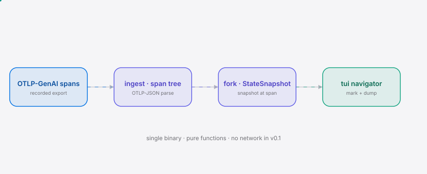
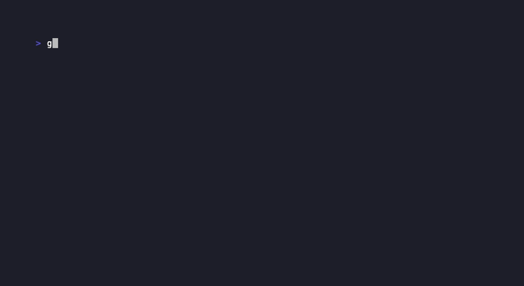

<div align="right"><sub><a href="./README.md">English</a>&nbsp;&nbsp;⇄&nbsp;&nbsp;<b>简体中文</b></sub></div>

<picture>
  <source media="(prefers-color-scheme: dark)" srcset="./assets/hero-dark.svg">
  <source media="(prefers-color-scheme: light)" srcset="./assets/hero-light.svg">
  
</picture>

<p align="center"><sub>ForkSpan 是面向 IR 工程师、对被攻陷的 agent 运行做反事实回放的 fork 原语。</sub></p>

**别再杀掉运行、丢掉因果链——在入侵 span 处 fork 已记录的状态，回放反事实分支以定位触发载荷。**

<p align="center">
  <a href="./LICENSE"></a>
  &nbsp;<a href="https://github.com/SuperMarioYL/forkspan/releases"></a>
  &nbsp;<a href="https://github.com/SuperMarioYL/forkspan/actions/workflows/ci.yml"></a>
  &nbsp;
  &nbsp;
</p>

## 目录

- [为什么需要它](#为什么需要它)
- [架构](#架构)
- [安装](#安装)
- [快速开始](#快速开始)
- [用法](#用法)
- [演示](#演示)
- [路线图](#路线图)
- [许可](#许可)

## 为什么需要它

当一个自主 agent 在运行中被攻陷（提示注入、工具调用劫持、策略逃逸）时，今天唯一安全的做法是杀掉运行——但这会切断那条本可解释攻陷*如何*触发的因果链。IR 循环只剩下一个只读时间线和一段推断，永远得不到受控实验。ForkSpan 把"在 span X 处 fork 已记录状态、回放反事实"做成一等原语，运行在 OTel-GenAI span 之上，让操作者能*证明*哪个载荷驱动了攻陷，而不是争论它。OTel-GenAI span 标准是那把钥匙：一个公共的 span 单元，状态可在此被快照、分支差异可在此被机器校验。这正是 [affaan-m/ECC](https://github.com/affaan-m/ECC) 这类 agent 运行时生态所缺少的取证原语——最接近的类比是面向 agent 流的 [langgenius/dify](https://github.com/langgenius/dify)，但谁都没有在已记录 span 上 fork 反事实分支。

> **诚实接缝：** v0.1 对已记录 span 做的是*结构性*反事实投影——不重跑 LLM。每处不确定的分歧都通过 `NeedsReExec` 标出，而非默默声称已执行。实时重跑在 v0.1 之后。

<h2> 架构</h2>

<picture>
  <source media="(prefers-color-scheme: dark)" srcset="./assets/atlas-dark.svg">
  <source media="(prefers-color-scheme: light)" srcset="./assets/atlas-light.svg">
  
</picture>

单一二进制、三层、无守护进程、v0.1 不联网。Ingest 是纯 JSON 解析（无 OTLP 收集器、无实时尾随）。Fork 与 diff 是 span 树上的纯函数。TUI 是唯一的交互界面——一个进程、一个二进制、演示只需一条无配置命令。

<h2> 安装</h2>

```bash
go install github.com/SuperMarioYL/forkspan/cmd/forkspan@latest
```

或从源码构建：

```bash
git clone https://github.com/SuperMarioYL/forkspan
cd forkspan && go build -o forkspan ./cmd/forkspan
```

需要 Go 1.24+。macOS/Linux 为主（TUI/tty）；Windows 尽力而为。

<h2> 快速开始</h2>

```bash
go build -o forkspan ./cmd/forkspan
./forkspan inspect assets/sample-compromised-trace.json            # 在内置的被攻陷 agent 轨迹上打开导航器
./forkspan inspect assets/sample-compromised-trace.json -s 0a0b0c0d0e0f0a0b --json   # 在入侵 span 处导出 StateSnapshot
```

<details><summary>示例输出</summary>

```
{"at_span_id":"0a0b0c0d0e0f0a0b","reached_spans":[
  {"span_id":"0102030405060708","name":"agent.invoke","role":"Agent","kind":"SPAN_KIND_INTERNAL","status":{"code":"STATUS_CODE_OK","message":""},"intrusion":false,...},
  {"span_id":"0a0b0c0d0e0f0a0b","name":"llm.chat","role":"LLM","kind":"SPAN_KIND_INTERNAL","status":{"code":"STATUS_CODE_OK","message":""},"intrusion":true,...}],
 "reachable_tool_calls":["1112131415161718","2122232425262728"],
 "agent_state":{...}}
```
</details>

<h2> 用法</h2>

三个子命令：`inspect`（m1，已实现）、`fork` 与 `replay`（m2/m3，路线图指针）。

```bash
# 1. 导航已记录的 span 树，标记入侵 span，fork 出 StateSnapshot。
./forkspan inspect trace.json
#   j/k 导航 · m 标记入侵 · s fork StateSnapshot → forkspan-snapshot.json · q 退出

# 2. 非交互式打印已记录的 span 树以发现 span ID（CI / 脚本友好）。
./forkspan inspect trace.json --list

# 3. 非交互式快照导出到 stdout（从 --list 管道传入 span id）。
./forkspan inspect trace.json -s <spanId> --json > snapshot.json

# 4. 反事实 fork + 回放（m2 里程碑——v0.1 打印路线图指针）。
./forkspan fork --span <spanId> --block-tool bash
./forkspan replay --branch <id>
```

内置的 `assets/sample-compromised-trace.json` 是一条合成、HF 事件风格的轨迹：一次 `agent.invoke` 运行，其中 `llm.chat` span 里的提示注入载荷（预标记 `forkspan.intrusion=true`）驱动了两处外泄工具调用（`bash` → `http`）。该入侵 span 的可达工具调用集合恰好就是那两处外泄——即反事实（m2）将投影并对比的爆炸半径。

<h2> 演示</h2>



上面的流程脚本化于 [`docs/demo.tape`](./docs/demo.tape)，由 `demo` 工作流按需重渲染；提交进仓库的 `assets/demo.gif` 是事实来源。m1 里程碑在内置轨迹上端到端跑通 inspect + 快照导出路径。

<h2> 路线图</h2>

- [x] **m1 — ingest + 导航。** 将 OTLP-GenAI JSON 导出解析为 span 树 + 工具调用子图；TUI 导航器标记任一 span 为入侵 span 并导出 `StateSnapshot`。
- [ ] **m2 — fork + diff。** 在被标记 span 处快照状态，施加反事实变异（阻断工具 / 脱敏载荷 / 加固策略），投影下游工具调用子图，并渲染已记录与反事实的并排 diff，带 `NeedsReExec` 标记。
- [ ] **m3 — 打磨 + 演示。** 内置被攻陷 agent 轨迹、asciinema 录制、一条 `forkspan demo` 命令在 2 分钟内复现完整 fork/inspect/回放流程。
- [ ] **v0.1 之后 — 实时重跑。** 在已快照状态上做确定性 agent 回放，以确认不确定的分歧（闭合 `NeedsReExec` 接缝）。

### ForkSpan 与相邻工具对比

| 维度 | ForkSpan | [affaan-m/ECC](https://github.com/affaan-m/ECC) |
|---|---|---|
| 在某 span 处反事实 fork | ✓ | — |
| 已记录状态快照（不重跑） | ✓ | — |
| OTel-GenAI span 消费者 | ✓ | partial |
| 实时评估 / 重跑框架 | partial（`NeedsReExec`） | ✓ |
| 入侵取证聚焦 | ✓ | — |

ECC 是更宽的 agent 运行时/评估参照；ForkSpan 与之互补——是那些运行时已采集 span 的取证消费者，而非竞争者。

<h2> 许可</h2>

MIT——见 [LICENSE](./LICENSE)。欢迎提 issue 与 PR；附上一份脱敏的被攻陷 agent 轨迹以在真实数据上复现 fork 流程。

推送后设置仓库 topics，让取证受众能找到它：

```bash
gh repo edit --add-topic agent --add-topic otel --add-topic opentelemetry --add-topic forensics --add-topic llm-agents --add-topic tracing
```

## 分享它

```
ForkSpan —— 为被攻陷 Agent 运行打造的 fork 原语。在入侵 span 处对已记录状态做快照，基于 OTel-GenAI span 回放反事实以定位触发载荷，而不必杀掉运行。 https://github.com/SuperMarioYL/forkspan
```

<p align="center"><sub><a href="./LICENSE">MIT</a> © 2026 SuperMarioYL</sub></p>
